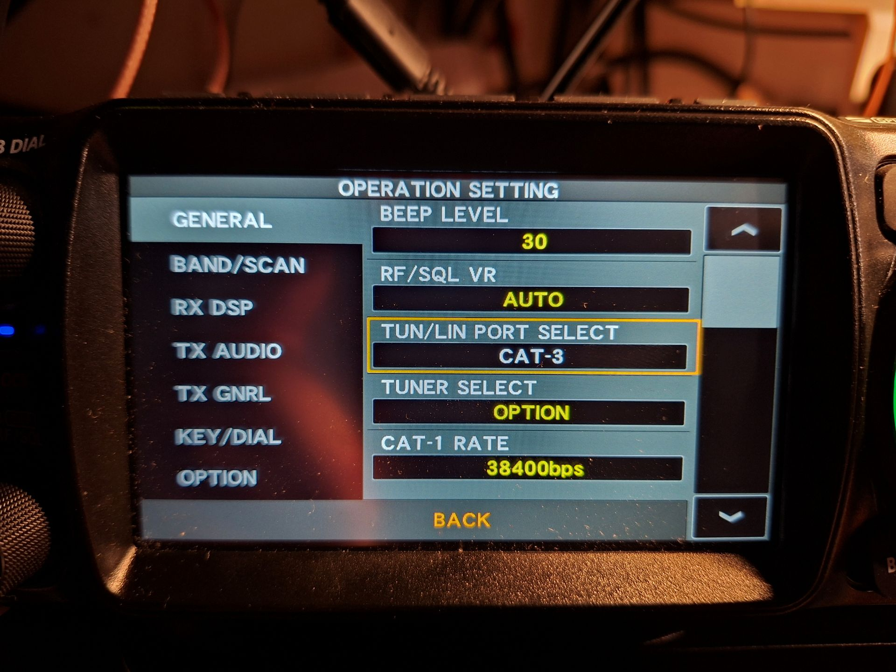
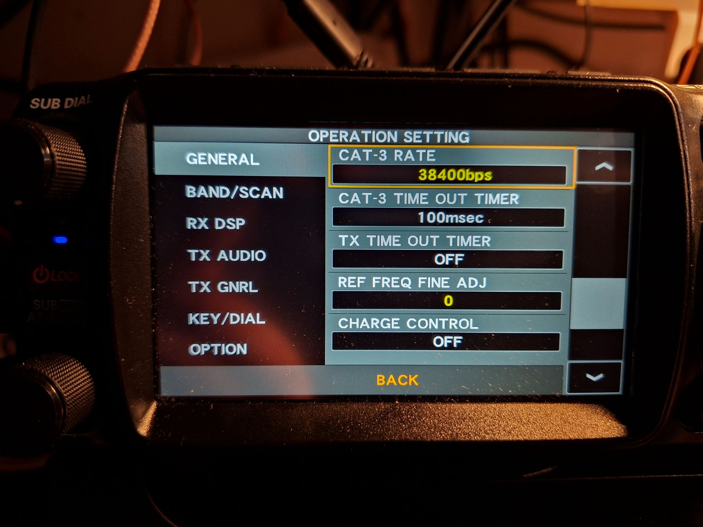
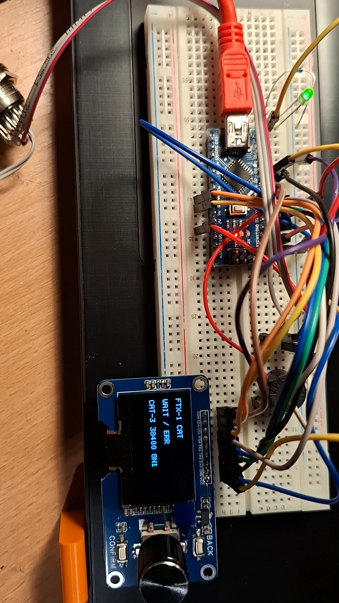
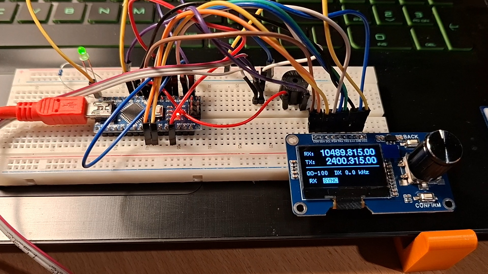
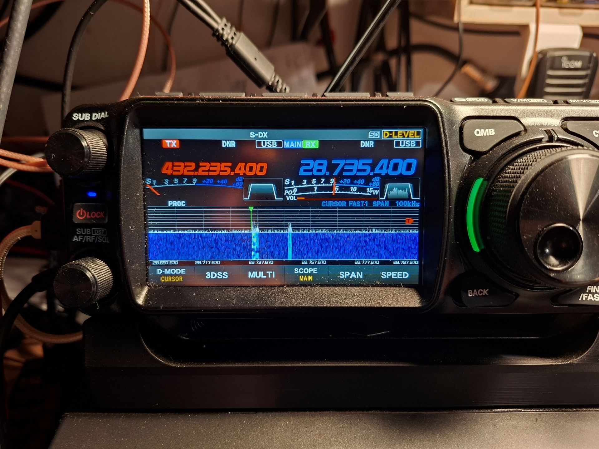

# FTX-1 QO-100 CONTROLLER

A compact Arduino-based CAT monitor and QO-100 controller for the **Yaesu FTX-1** and **DX Patrol UP/DOWN converter**, featuring an adjustable **DX offset** for precise uplink frequency correction.

It focuses on two functions:

- **QO-100 DX** – calculates and synchronizes the SUB transmit frequency from the MAIN receive frequency.
- **CAT 1** – provides a transparent CAT connection between the FTX-1 and PC software such as Omni-Rig.

---

## Features

### QO-100 DX

The controller uses the FTX-1 MAIN and SUB VFOs for QO-100 operation:

| Function | Setting |
|---|---|
| MAIN | RX: 28.500–29.000 MHz |
| SUB | TX: 432.000–432.500 MHz |
| Split | ON |
| TX side | SUB |
| Mode | USB |
| RIT | OFF |

The SUB frequency is calculated as:

```text
SUB = MAIN + 403.500.000 Hz + DX offset
```

The adjustable DX offset has the following range and step:

- Range: **−25.0 kHz to +25.0 kHz**
- Step: **2.5 kHz**

### CAT / ERR indication

The meaning of the CAT/ERR status depends on the operating mode:

- **QO-100 DX:** based on validated replies returned by `FTX1CAT::readState()`.

---

## FTX-1 configuration

For CAT communication, configure the radio as shown below.

1. In **Operation Setting**, select **TUN/LIN PORT SELECT → CAT-3**.
2. Set **CAT-1 RATE → 38400 bps**.
3. In the CAT-3 settings, set **CAT-3 RATE → 38400 bps**.
4. The displayed **CAT-3 TIME OUT TIMER** setting is **100 msec**.

### CAT-3 port selection



### CAT-3 communication rate



---

## Hardware and display

The project is shown running on an Arduino Nano with an OLED display.

### CAT monitor



### QO-100 DX synchronized



### Radio operating screen



---

## Installation

1. Open the Arduino sketch in the Arduino IDE.
2. Install the **FTX1CAT** library and make sure it is available to the sketch.
3. Connect the controller to the FTX-1 CAT-3 interface.
4. Select the correct Arduino board and serial port, then compile and upload the sketch.
5. Configure the FTX-1 CAT settings as described above.

> **Important:** The `FTX1CAT` library must be installed alongside this sketch (in the Arduino libraries folder).

---

## Important notes

- QO-100 DX initialization does **not** use the PC/1W command. The documented FTX-1 CAT power command for the field head does not provide a 1 W value.

---

## Demonstration

https://github.com/user-attachments/assets/15ab2a6d-adcf-4df5-9ac8-b0c0cf689826

---

## License

See the [`LICENSE`](LICENSE) file for the terms of use.

**73! Martin OK1UM**
